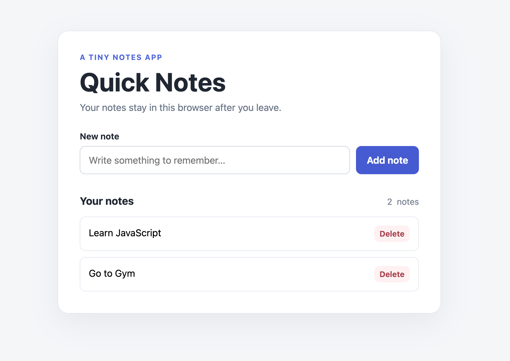

# Quick Notes 📝

A simple notes app built with **HTML, CSS, and Vanilla JavaScript**. Add notes, delete them, and keep them saved in your browser using LocalStorage.

## 📸 Screenshot



## ✨ Features

- Add new notes
- Delete individual notes
- Save notes using browser LocalStorage
- Restore notes after refreshing the page
- Display the number of notes
- Show an empty-state message when no notes exist
- Prevent empty or whitespace-only notes

## 🛠️ Technologies Used

- HTML5
- CSS3
- JavaScript (Vanilla JS)
- Browser LocalStorage API

## 🚀 Getting Started

1. Clone this repository:

   ```bash
   git clone https://github.com/yogesh-banday/quick-notes-app.git
   ```

2. Open the project folder.
3. Open `index.html` in your browser.

No installation or external dependencies are required.

## 💾 How It Works

The app stores note text in a JavaScript array and uses `JSON.stringify()` to convert the array into a string before saving it to LocalStorage.

When the page loads, the saved data is retrieved with `localStorage.getItem()` and converted back into an array using `JSON.parse()`. The app then recreates the notes in the page.

## 📁 Project Structure

```text
quick-notes-app/
├── index.html
├── styles.css
├── app.js
├── screenshot.png
└── README.md
```


## 👨‍💻 Author

Built as a web development learning project.